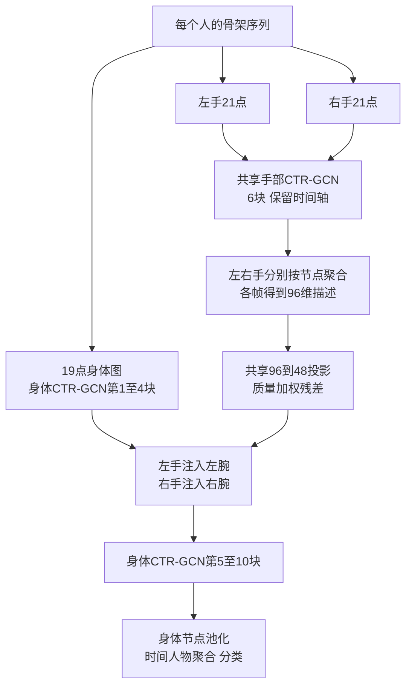

# 手部 CTR-GCN 特征注入手腕方案 V2：100帧压缩、100轮、逐批余弦学习率

日期：2026-10-14（Asia/Tokyo）。状态：新增代码已实现，训练结果待服务器 CUDA 编译验收和正式训练；文中的指标与对照结果仍属于拟议验收项，不代表已有结果。按用户要求保留此前100帧置信度压缩，将训练改为100轮，学习率由分段衰减改为逐训练批次的warmup+余弦调度；网络结构保持原方案。

## 1. 目标与固定边界

删除面部细节点及面部分支。双手分别通过共享 CTR-GCN 编码，将每帧手部语义注入同一人物的对应身体手腕，随后由身体 CTR-GCN 联合传播与分类。研究问题是：中间的手腕融合是否比分类前的身体—手部融合更有效，尤其针对细微手部动作。

新建独立模型、入口、配置和输出目录，保留原最佳模型、旧入口、历史实验及其他任务修改。保留双手距离和方向。所有独立训练从随机初始化开始，不加载原最佳权重。不默认增加满宽度官方骨干、跨人物交互、复杂门控、蒸馏或额外损失，以便解释实验。

训练默认并强制 torch.compile，专用与通用入口均拒绝 --no-compile，编译失败报错，不静默切换整模型 eager。首次实现必须在服务器验证真实 CUDA 编译前向、反向及优化器更新。

## 2. 总体结构



这里的全身表示包括粗头部、上肢、躯干、下肢和足部。手指通过手腕摘要进入主图，并非在最终主图直接保留全部细手节点。每个人独立编码，第一版不建立跨人物图边。

## 3. 输入、节点与拓扑

为兼容已有 ZIP 数据和工具，模型仍接收 B×3×T×133×M，通道为原始 x/y/score；第一版 T=100、M=2。保留输入容器不意味着使用面部细点：索引23至90不参与特征、置信度、归一化或图构造中的数据计算；输入鼻点0仍是粗头部定位点。

主图节点顺序固定为：

```text
[0, 5, 6, 7, 8, 9, 10, 11, 12, 13, 14, 15, 16,
 17, 18, 19, 20, 21, 22]
```

| 主图位置（零基） | 原RTMW索引 | 含义 |
|---|---|---|
| 0 | 0 | 鼻点，粗头部位置 |
| 1 / 2 | 5 / 6 | 左肩 / 右肩 |
| 3 / 4 | 7 / 8 | 左肘 / 右肘 |
| 5 / 6 | 9 / 10 | 左腕 / 右腕，注入位置 |
| 7 / 8 | 11 / 12 | 左髋 / 右髋 |
| 9 / 10 | 13 / 14 | 左膝 / 右膝 |
| 11 / 12 | 15 / 16 | 左踝 / 右踝 |
| 13至15 | 17至19 | 左足三点 |
| 16至18 | 20至22 | 右足三点 |

左手分支使用91至111共21点；右手分支使用112至132共21点。手根91/112仍进入手部编码，但不再作为独立身体节点。原最佳22点主图中的56为面部细点，删除；91/112与身体手腕语义重复，合并为左右腕两个融合位置。不能把133原始索引9/10误当作19点图位置9/10；实际融合位置是5/6。

身体图采用三分区：self、inward、outward；保留身体及足部自然边。仅抽取19点会使鼻点缺少静态邻居，因此第一版显式加入(0,5)、(0,6)作为粗头部—双肩连接。它们是设计的语义连接，不是额外观测的颈部骨骼。方向按固定边表构造，反向进入outward，分别归一化并存入配置。身体19点末端融合、身体19点单独训练、手腕注入三个受控版本必须使用相同拓扑。旧22点模型与新图的差异另行报告；若要测头部连边效应，单独测试保留诱导图的版本。

手部图保留每只手的21点自然骨架（手根连接五条手指链）、self/inward/outward分区及现有CTR可学习关系机制。左右手共享编码参数，节点对应顺序一致。关系学习与时间卷积实现沿用当前最佳，不在本实验中换成默认10块、256输出通道的官方满宽骨干。

## 4. 特征与掩码

身体输入沿用原最佳原始x/y/score以及masked PointBatchNorm。手部输入沿用现有6通道：躯干相对x/y、score、双手对应点距离、双手方向x/y。

躯干中心由有效肩髋点计算，双手距离使用肩中点到髋中点的躯干长度归一化；左手方向由左指向右，右手取相反方向。某对手点缺失时对应距离和方向置零，不能将缺失当作距离为零的真实接触。禁止左右手在不同人物之间计算距离。

原始点有效条件为score>0且坐标/score有限，并与有效帧mask相与。先清理NaN/Inf及无效位置，再参与坐标变换；不能通过NaN×0清理。score用于质量计算时裁剪至[0,1]。躯干尺度应有有效肩观测和有效髋观测且长度超过epsilon；不可靠时置零归一化距离，并标记质量，不能让极小分母产生巨大数值。第一版几何失败帧关闭手腕注入，保留身体路径；需要记录关闭比例，防止实际手部分支被大量屏蔽。

手部没有观测时所有手特征、聚合描述及注入量为零。不得混合人物槽位或提前对左右手求平均。沿用已有的人物槽位与时间协议，不重新排序，不按动作标签改变人数规则。

## 5. 网络层数与尺寸

以单人物批次B'=B×M表示，下表取100帧。第一版复用原最佳CTRGCNBlock的图卷积、多尺度时间卷积、归一化和残差实现。

| 模块 | 通道 | 时间步长 | 输出尺寸 |
|---|---|---|---|
| 身体输入 | 3 | — | B'×3×100×19 |
| 身体块1至4 | 48,48,48,48 | 1,1,1,1 | B'×48×100×19 |
| 每手输入 | 6 | — | B'×6×100×21 |
| 共享手块1至6 | 32,32,64,64,96,96 | 全为1 | B'×96×100×21 |
| 每手节点聚合 | 96 | 不下采样 | B'×96×100 |
| 手部投影 | 96→48 | 1 | B'×48×100 |
| 左右腕注入 | 48 | 1 | B'×48×100×19 |
| 身体块5至7 | 96,96,96 | 2,1,1 | B'×96×50×19 |
| 身体块8至10 | 192,192,192 | 2,1,1 | B'×192×25×19 |
| 节点聚合 | 192 | — | B'×192×25 |
| 时间、人物聚合 | 192 | — | B×192 |
| 身体投影及分类 | 192→192→60 | — | B×60 |

注入在第4块后、第5块时间下采样之前：手与身体时间长度完全一致，无需用插值对齐。64帧对照则主干时间长度为64→32→16。左、右手共享同一个编码器及投影模块，可以将手别作为额外批次维一次计算，但必须以固定索引恢复每个人每只手的身份。

## 6. 第一版融合规则

第一版使用masked节点均值，暂不加入注意力或动作门控，避免同时改变过多机制。对每个手别s、人物m和时间t：

\[
h_s(t)=\frac{\sum_{j=1}^{21}v_{sj}(t)H_{sj}(t)}{\max(\sum_jv_{sj}(t),1)}\in\mathbb{R}^{96}.
\]

仅聚合节点，不聚合时间。手部输入置信度已参与编码，第一版不额外按score加权隐藏特征，以便与现有手节点聚合保持接近。

共享无偏置Linear(96,48)与按通道LayerNorm生成p_s(t)。归一化后再次用手部有效mask清零，避免LayerNorm可学习偏置让空手产生特征。

质量权重：

\[
q_s(t)=\frac1{21}\sum_{j=1}^{21}v_{sj}(t)\operatorname{clip}(score_{sj}(t),0,1).
\]

分母固定为21，使缺失率和检测置信度同时影响质量。q仅是观测可靠性，不是动作重要性，也不能保证检测错误一定得到低分。几何无效帧注入量置零。

共享标量alpha=sigmoid(a)，初始alpha=0.1，a=log(0.1/0.9)。残差投影随机初始化，避免整个注入路径初始化为完全零而阻断早期学习。

\[
d_s(t)=\alpha q_s(t)p_s(t),\qquad
F'_{w_s}(t)=\operatorname{ReLU}(F_{w_s}(t)+d_s(t)).
\]

仅更新对应手腕，其余17个主节点保持当前特征；所有主节点随后进入剩余身体块。固定左右腕选择矩阵或broadcast构造整图残差，避免依赖数据的Python循环和不必要的原地写入。

手腕原始点缺失而该手特征有效时：保持原始手腕坐标/score无效，不伪造几何；注入时将该腕的特征mask更新为“原腕有效 OR 手部有效且q>0且几何有效”。该mask表示语义特征有效，独立于原始观测mask。此时F腕原值为0，注入创建有效手部语义token，使其不被后续masked GCN删除。两者都无效时仍为零。明确记录这种语义补充的出现比例，并可用“禁止补充缺失腕”的独立对照检查影响。

共享alpha简化第一版，并不保证左右手同等有用；不提前平均两手，而由注入位置和后续身体图学习差异。后续可独立比较左右alpha、逐帧质量门控、节点注意力等方案。

## 7. 读出与损失

身体第10块后，对19个主节点进行mask均值；保留原最佳身体路径的固定时间平均与人物槽位平均，再经Linear(192,192)+ReLU和Linear(192,60)分类。第一版没有面部头、独立手部末端拼接或独立手部分类头。

选择沿用原时间/人物聚合是为了让第一轮主要比较融合位置。固定平均可能稀释补齐帧或空人物槽位的表示，作为已知限制报告；不能在这轮悄悄替换为全面有效位置归一化。若后续改变读出，末端融合和手腕注入两个受控版本同时改，并单独记录效果。

第一版损失仅为最终60类交叉熵：L=CE(z,y)。最终损失通过身体后6块、融合投影反传至手部编码，联合优化所有模块，不冻结主干，不使用教师或预训练权重。若实测手部贡献弱，再独立增加左右手辅助CE；辅助头不得自动进入第一版，更不能将其收益归为手腕融合。

## 8. 时间协议与训练设置

第一版沿用已有池化+100帧的置信度全序列压缩：长序列划成100个连续区间，每点按score平均坐标；短序列保留原帧再补齐，保留帧mask。训练与验证同协议，不随机时间裁剪。保留100帧为的是先检查结构变化，不代表已经确认这种压缩最适合手部。

| 项目 | 第一版固定值 |
|---|---|
| 数据/划分 | 原RTMW ZIP、NTU60 XSub，相同manifest与保留样本 |
| 类别/人物/窗口 | 60 / 2 / 100 |
| batch / 验证batch | 32 / 32 |
| 梯度累积 | 1 |
| 轮数 | 100 |
| 优化器 | SGD，momentum=0.9，Nesterov=true |
| 峰值LR / weight decay | 0.1 / 0.0004 |
| warmup | 保留前5轮，改为每个训练批次线性预热，从首批0.001升至0.1 |
| 最小LR | 0.0001，作为本方案推荐默认值，需实测验证 |
| 衰减 | 后95轮每个训练批次进行单周期余弦衰减；取消35/55节点，不重启 |
| scheduler计数单位 | optimizer update；固定grad_accum_steps=1，每训练batch恰好一次更新 |
| 梯度裁剪 | 第一版0，沿用池化+100帧；新增裁剪需同步受控基线 |
| seed | 初次1，正式比较至少1/2/3 |
| workers / prefetch | 8 / 4，按服务器资源核验 |
| compile | required=true，backend=inductor，mode=reduce-overhead |
| TF32 / cuDNN | 沿用当前服务器已验证设置，记录实际版本 |
| 初始化 | 每次独立实验随机初始化 |

### 8.1 学习率的精确定义

本方案将“100轮”解释为100个epoch；窗口长度仍为100帧，两者独立。每批大小32、drop_last=true，按已有39,627训练视频计算，K=floor(39,627/32)=1,238训练batch/轮；总更新S=100K=123,800，warmup更新W=5K=6,190，余弦更新C=S-W=117,610。实际K必须读取len(train_loader)，不能硬编码；验证510批不计入学习率进度。

令u为当前optimizer update的零基编号，取0至S-1。在该batch的optimizer.step之前设置学习率，定义eta_start=0.001、eta_max=0.1、eta_min=0.0001：

\[
\eta(u)=
\begin{cases}
\eta_{start}+(\eta_{max}-\eta_{start})\frac{u}{W-1},&0\le u<W,\\
\eta_{min}+\frac12(\eta_{max}-\eta_{min})\left[1+\cos\left(\pi\frac{u-W}{S-W-1}\right)\right],&W\le u<S.
\end{cases}
\]

本配置W>1且S-W>1；实现须验证这些前提，不能依赖除零后的数值处理。此定义保证第一批0.001、warmup最后一批0.1、余弦第一批0.1、整个训练最后一批0.0001。warmup与余弦交界的两批均使用峰值，避免端点跳变。第一阶段每批增加学习率，第二阶段每批余弦下降；“每批余弦”不表示取消既有warmup。eta_start和eta_min为本版明确推荐默认值，尚不是已有实验确认的最佳值。

在epoch边界处，余弦进度p对应完成的轮数约为5+95p。参考值：

| 训练位置（近似epoch边界） | LR |
|---|---|
| 第1个训练batch | 0.001 |
| 第5轮结束 / 第6轮开始 | 0.1 |
| 第25轮结束 | 约0.08947 |
| 第50轮结束 | 约0.05418 |
| 第75轮结束 | 约0.01622 |
| 第95轮结束 | 约0.000781 |
| 第100轮最后一批 | 0.0001 |

这些是边界参考，实际每批按u计算；不是每轮只设置一次这些值。第36/56轮不再产生学习率跳变。新曲线第50轮LR仍约0.054，与旧计划第50轮0.01不同，因此它不只是让原曲线更平滑，而是改变了整个优化轨迹。

### 8.2 调度与训练顺序

```text
读取已完成的optimizer更新数 u
for 每个训练batch:
    根据u、S、W计算并设置所有optimizer参数组LR
    zero_grad → 编译模型前向 → loss → backward
    optimizer.step
    u += 1
    记录该批实际使用的LR和更新编号
```

学习率控制放在Python训练循环，编译模型张量运算；不通过torch.compiler.disable排除新编码与融合。完成验证、保存权重或打印日志时不推进u。可以由global_optimizer_step直接计算LR，不必依赖有隐式初次step偏移的scheduler对象；如果使用现成scheduler，必须证明其端点与本公式一致。

第一版grad_accum_steps固定为1；如果以后另开梯度累积实验，按optimizer更新定义总步数和warmup，不能混用microbatch编号使调度提前结束。该变更另行记录，不悄悄修改当前每训练batch一次更新的约定。若优化器更新被跳过（例如未来加入AMP后溢出），u只统计真实更新，同时日志独立记录读入batch数和跳过原因；第一版不新增AMP。

训练不回滚best.pt再继续余弦：默认从当前参数和SGD动量连续优化，best.pt仅保存验证最优，last.pt用于恢复。每轮验证一次，不用验证波动重置余弦、不采用warm restart、不进行周期重启。若遇非有限loss/梯度，明确报错并保留诊断，不把跳过失败batch作为正常完成。

恢复必须保存已完成更新数u、S/W、start/max/min LR、调度版本、每轮K、optimizer动量、随机状态和训练进度。恢复后下一batch使用eta(u)，继续原100轮计划；不能重新warmup、重新计算余弦起点，或将剩余轮数当作新的100轮。模型/数据/步数不匹配时拒绝静默恢复。

### 8.3 调度保存与验收

拟议配置明确记录epochs=100、window_size=100、temporal_compression=confidence_weighted、scheduler=warmup_cosine、scheduler_step_unit=optimizer_update、warmup_epochs=5、warmup_start_lr=0.001、lr=0.1、min_lr=0.0001、cosine_restarts=false、grad_accum_steps=1、total_updates和warmup_updates。旧lr_steps必须为空或标记不适用，不能同时执行旧milestone逻辑。

每batch日志保存实际LR；epoch日志保存lr_first/lr_last/lr_mean，避免把整个epoch描述为单一LR。checkpoint同时保存更新计数与调度配置，源代码快照包含本调度版本。预设、通用参数解析、实际训练循环、保存配置四处同时核查。

必要测试验证：首批/预热末批/余弦首批/最终批端点，余弦段非增，跨epoch连续，验证不推进LR，断点恢复与不间断训练同一步LR一致，K读取实际loader且只计训练，旧milestone不再生效。100帧压缩和默认强制compile的已有回归继续保留；服务器真实CUDA编译前后向验收要求不变。

新增训练入口拒绝关闭编译、任意init-checkpoint和跨架构权重。第一版不提供权重加载式“开始训练”；如以后新增故障恢复，只允许恢复同一架构同一协议的模型、优化器、随机状态和完整进度，明确是同一随机初始化实验的继续，不是加载原最佳微调。

该模型不含原面部LocalSTBlock，因而无需该面部分支的eager边界；身体/手部CTR编码、节点聚合、质量计算、投影、残差融合、后续主干与分类头必须进入torch.compile。不能承诺fullgraph无断图，需检查实际编译报告。保留旧模型原边界，不修改旧编译行为。

## 9. 必做对照及解释边界

所有新增对照使用相同数据、100帧压缩、100轮、逐批warmup+余弦学习率、随机初始化、compile、SGD和预算。同一服务器后端复测；必要时保存旧最佳的当前复测作为参考，而不重新覆盖旧实验。

| 编号 | 模型 | 用途 |
|---|---|---|
| R0 | 历史最佳22点+双手+面部，末端融合 | 历史整体参考，已有复测93.6404%，不是受控单变量基线 |
| R1 | 去面部分支及面部主点56，21点身体保留手根，身体—手部末端融合 | 检查去面部的净影响，分类头同步去除面部输入 |
| R2 | 19点身体、上述新拓扑、双手分别保留至末端融合 | 手腕注入的主要受控参照；身体/手编码、节点、几何及质量计算与R4一致 |
| R3 | 同拓扑19点身体，无手部语义注入 | 检查细手信息的独立增量；参数/计算不同需报告 |
| R4 | 本方案19点身体、第4块后左右腕注入 | 主要新方案 |

增加R0-C：保留原最佳22点+双手+面部结构及100帧压缩，从随机初始化使用相同100轮逐批余弦训练。历史R0的93.6404%来自65轮milestone计划，只作历史参考；R0-C用于区分新训练预算/调度与新架构的贡献。不能拿R4对历史R0的差值直接宣称是去面部或手腕注入的提升。

R1→R2包含手根合并和粗头连接变化，不能仅解释为去重复节点。R2→R4比较中间融合与末端融合，投影、读出输入及参数量有不可避免的差异，需报告；R2的末端路径保留左右手描述，可将双手质量加权投影后拼接，不提前平均。若声称纯融合位置收益，应再做保留相同投影模块、相同分类特征预算的匹配对照。

第一轮可先训练R2与R4验证主要问题，再补R1与R3，正式结论基于完整对照和多seed。分阶段变更只影响新实验，不改旧记录。

在R4基础上后续独立检验：第2/4/7块注入、masked均值/手根token/位置感知注意力聚合、固定alpha=0.1/可学习alpha、质量权重开关、是否保留独立手部读出、100帧真实帧采样与置信度平均压缩。一次只改变一个问题。真实帧采样应完整覆盖全序列，评估固定确定性采样，不能仅恢复随机短裁剪而裁掉关键阶段。

## 10. 评估、诊断与验收

所有模型报告整体Top-1/Top-5、macro recall/macro-F1、逐类召回、混淆对、参数量、峰值显存、稳态训练与推理吞吐、编译冷启动与总墙钟时间。吞吐测量需固定batch、精度、后端、输入协议，CUDA同步计时并区分编译与热运行。

重点动作：阅读、写字、玩手机、拍手、搓手、打电话、穿鞋/脱鞋，以及双人动作。手部11类固定清单为A010/011/012/013/028/029/030/031/032/033/034；作为全60类模型后验子集统计，不冒充独立Hand11论文复现。当前100帧模型总分提升而该子集下降，因此整体和子集需同时呈现。

保存每个验证视频的标签、预测、概率和样本ID，确保manifest与样本集合一致，执行配对错误修正/新增分析。配对检验只描述固定checkpoint的视频差异；多seed均值与标准差用于判断训练可重复性，验证选best和多次选型的偏差另行说明。

诊断记录：alpha、左右q分布、无手/几何失败/缺失腕补充比例、每腕注入范数/原腕范数、手部编码与投影梯度范数、实际编译范围。范数诊断在原腕接近零时单独计数，不能让epsilon比值假装是可靠统计。选择少量固定批次采集诊断，避免频繁host同步拖慢训练。

在同一个R4 checkpoint评估时置注入量为0，可测联合训练模型对手部注入的依赖；它不等于独立训练的R3或旧最佳。若该干预几乎不影响预测且手部分支梯度/注入范数很小，应先排查路径和掩码，不直接宣布手部无效。

必要回归包括：面部索引23至90任意改变而输出不变；左右手/人物映射正确；手部无效时注入严格为零；缺失腕补充mask符合规则；全无效输入仍有限且无语义注入（分类器偏置可产生有限非零logits）；双手距离方向保留；短帧补齐不进入有效统计；默认compile并拒绝--no-compile；配置与checkpoint重建一致。支持输入形式和CUDA测试覆盖真实训练尺寸、前向、反向、优化器更新以及train/eval切换，不能用dry-run或eager后端代替真实Inductor编译验证。

## 11. 拟议工程组织

| 新增或扩展位置 | 职责 |
|---|---|
| isaa/models/hand_ctr_wrist_fusion.py（新增） | 独立19点图、双手CTR、残差注入与读出，已实现 |
| configs/hand_ctr_wrist_fusion.json（新增） | 节点、宽度、注入位置、投影、质量、训练和编译配置，已实现 |
| train_hand_ctr_wrist_fusion.py（新增） | 固定新架构和默认训练协议，拒绝关闭compile及预训练初始化，已实现 |
| isaa/train.py（仅增量接入） | variant注册、参数检查、实际compile、完整配置保存 |
| tools/evaluate_best.py（仅增量接入） | 按checkpoint重建本模型和时间协议 |
| tests/test_hand_ctr_wrist_fusion.py（新增） | 数据路由、缺失点、面部独立性、编译约束与恢复重建测试 |
| outputs/hand_ctr_wrist_t100_e100_cosine_ntu60_xsub/<run>/ | 新实验记录与权重，目录明确区分100帧与100轮，独立于旧最佳 |

配置和checkpoint必须保存：architecture版本、RTMW/主图索引映射、左右手索引与对应顺序、身体/手部边表与三分区、通道和步长、注入块4、节点聚合方式、投影/归一化、alpha初始化和终态参数、质量公式及几何失败规则、观测/语义mask语义、读出、时间压缩/增强、100轮训练计划、逐批余弦及warmup定义、实际更新总数和当前更新编号、初始化来源、compile实际设置与范围、数据身份、代码快照及运行环境。

修改训练时核查预设、通用解析、compile调用、保存配置四处一致。服务器CUDA验证通过后才启动完整独立训练。只提交本任务文件，保留本地与服务器的其他实验变更。

## 12. 优缺点与判断标准

优势是建立明确的细手→对应腕→身体上下文信息路径，保留左右手和时间身份，避免细手与身体只在最终分类前相遇，并去掉面部细分支。它有机会改善依赖手形与身体相对位置的动作，也方便逐腕质量控制。

风险是21点压缩到一个语义位置、全身传播与池化稀释细节、检测误差污染身体关系、缺失腕语义补充改变mask、去面部损失局部信息，以及串联监督加深手部梯度路径。去掉面部不保证大幅提速：现有面部只有6个token，手部6块CTR仍保留。参数量和速度须实现后实测，不根据删除68个输入索引直接推断。

如果原100帧压缩已平滑了关键手指运动，后续注入无法恢复输入中丢失的信息；因此采样对照不可省略。第一版没有跨人物边，不能声称解决了“甲手触碰乙身体”的显式交互。该结构也不是首次提出局部特征注入主图：项目旧RTMWLocalCTR已有区域特征注入，创新应由具体机制及受控结果支持。

成功标准是R4相对R2在多个seed下稳定改善，整体准确率和重点手部指标均有可解释表现，注入确实参与预测，训练与编译稳定，资源代价可接受。若只有总分升而阅读/写字继续下降，应按任务目标判断是否值得采用；若手部贡献有效但被读出稀释，再测试辅助监督或独立手部读出。当前不预估能达到94%或任何新准确率。

参考实现：isaa/models/body_local_fusion.py（当前双手CTR与晚融合），isaa/models/rtmw_local_ctr.py（CTR块、旧区域注入），isaa/layouts/rtmw_133.py（索引与骨架边），isaa/data/rtmw_zip_dataset.py（置信度时间压缩）。参考结果：outputs/evaluations/pool_weighted_100_20261012/analysis.md。
