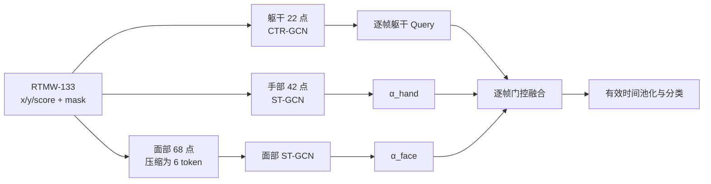

# 基于 RTMW 骨架的可解释动作分析：阶段性研究报告

**报告日期：** 2026 年 10 月 5 日  
**项目：** ISAA（Interpretable Skeleton-Based Action Analysis）  
**当前代码版本：** `21804f2`

## 摘要

本阶段研究面向基于二维人体骨架的动作识别，使用 RTMW-133 关键点作为输入，探索“躯干主体运动 + 手部/面部局部运动”的分支建模与可解释融合。工程以 CTR-GCN 为主体分支，并为手部和压缩后的面部 token 构建局部分支，处理缺失点、有效帧和多人输入。

目前已经完成一组 NTU60 XSub 全量训练：轻量 `BodyLocalFusion` 在 65 轮训练后取得 **89.60% 验证 Top-1** 和 **98.82% 验证 Top-5**，最佳结果出现在第 65 轮。该结果证明分支式骨架建模具备可用的识别能力，但训练集准确率已达到 99.84%，与验证集相差约 9.24 个百分点，仍存在明显过拟合。

最近的研究重点已转向逐帧跨分支融合：以躯干特征作为 Query，分别与手部、面部特征计算匹配分数，并学习独立的 `α_hand` 与 `α_face` 门控系数。该结构已经完成代码实现和时间尺度对齐，但当前仓库中还没有对应的全量训练结果，因此本报告将其作为下一阶段待验证方法，不把结构设计直接表述为性能提升。

## 1. 研究问题与目标

传统骨架动作识别通常把所有关键点放进同一个图卷积网络，容易把身体主干、手部细节和面部运动混在一起。当前研究围绕三个问题展开：

1. 在保留 RTMW-133 输入信息的同时，能否用少量主干节点完成稳定的动作识别？
2. 手部和面部等局部运动是否需要独立的时空分支，并在分类前与躯干信息融合？
3. 融合权重能否随时间和样本变化，从而为后续动作分析提供可观察的证据？

研究目标不是只追求分类准确率，也包括保留节点、区域、分支和有效性 mask，使模型输出能够支持遮挡、缺失点和局部贡献分析。当前实现中的特征和 CTR 边权仍然只是模型表示，不能直接等同于因果贡献；正式的可解释性结论需要额外的遮挡实验或反事实评估。

## 2. 数据与预处理

### 2.1 输入数据

- **骨架格式：** RTMW-133。
- **动作数据集：** 已完成训练记录对应 NTU60 XSub，60 类动作。
- **输入通道：** 当前 BodyLocalFusion 使用 raw `x/y` 与关键点置信度 `score`；历史 32 点 ISAA 对照使用 relative `x/y/score`。
- **人数：** 最多两人。
- **窗口：** 固定 64 帧。
- **缺失处理：** 由置信度和有限值共同生成节点 mask，并在池化、归一化和时间下采样中保留有效性信息。
- **归一化：** 以肩部和髋部组成的躯干区域估计中心并按躯干尺度归一化；该处理减少整体平移和尺度变化，但也可能削弱部分与绝对位置相关的动作线索。

### 2.2 节点划分

当前分支实验使用三类表示：

- **躯干/身体分支：** 从 RTMW 主节点中保留 22 个节点，使用 CTR-GCN 建模全身主体运动。
- **手部分支：** 42 个手部节点，使用 ST-GCN 建模局部时空变化。
- **面部分支：** 将 68 个面部点按固定区域压缩为 6 个 face token，避免直接在 133 点图上进行高成本计算。

主干分支和局部分支分别进行有效节点池化；空区域输出零，并通过 mask 阻止无效点参与统计。

## 3. 方法演进

### 3.1 BodyLocalFusion 当前默认主线

当前默认主线是 BodyLocalFusion，采用身体 22 点 CTR-GCN、手部 42 点和面部 6 token 的局部 ST-GCN，并在分类前进行有效位置池化、投影和融合。它使用全 RTMW-133 输入和 raw x/y/score，默认训练协议为 NTU60 XSub、64 帧窗口、65 轮和 batch size 32。

32 点真实主节点的 main-only CTR-GCN 已降为显式历史对照，用于速度、输入规范化和官方超参数适配检查。它不能直接加载官方 25 点模型权重，因为节点布局和输入表示不同。

### 3.2 BodyLocalFusion 分支模型

轻量分支模型使用 10 层 CTR-GCN 身体分支，通道宽度为 `48,48,48,48,96,96,96,192,192,192`，在第 5、8 层进行时间下采样。局部分支使用 4 层 ST-GCN，通道宽度为 `24,24,48,48`；其输入由 42 个手部节点和 6 个面部 token 组成。

两路特征分别做有效位置平均池化，身体特征投影到 192 维，局部特征投影到 96 维，拼接成 288 维向量后分类。这个版本用于建立“主体运动 + 局部细节”的可复现实验基线。

### 3.3 最近实现的改进方向

近期提交集中在以下结构和增强：

| 变体 | 研究意图 | 当前状态 |
|---|---|---|
| `body-local-dropout` | 在分支投影和分类器处加入 dropout，缓解分支融合过拟合 | 已实现，尚缺全量结果 |
| `body-local-relative` | 仅对手部/面部支路使用躯干相对坐标 | 已实现，尚缺全量结果 |
| `body-local-relative-split` | 将手部和面部完全拆成两个 ST-GCN | 已实现，尚缺全量结果 |
| `body-local-time-aug` | 引入随机时间裁剪、平移和轻量时间增强 | 已实现，尚缺全量结果 |
| `body-local-coord-aug` | 在坐标上加入小幅噪声，默认标准差为 0.003 | 已实现，尚缺全量结果 |
| `body-local-full` | 使用完整宽度的局部分支，作为容量对照 | 已实现，尚缺全量结果 |
| `torso-cross-attn` | 以躯干为 Query，对手部和面部进行独立跨分支门控 | 最新研究重点，尚缺全量结果 |
| `torso-cross-attn-official` | 使用更接近官方的 CTR-GCN/ST-GCN 特征提取器进行对照 | 已实现，尚缺全量结果 |

## 4. 最新跨分支注意力方法

最新方法首先分别提取躯干、手部和面部的时序特征，再将局部分支的时间长度插值到躯干分支的时间长度。设第 `t` 个时间步的特征分别为 `z_body(t)`、`z_hand(t)` 和 `z_face(t)`，各分支映射到 96 维后计算：

```text
s_hand(t) = <Wq_hand z_body(t), Wk_hand z_hand(t)> / sqrt(96)
s_face(t) = <Wq_face z_body(t), Wk_face z_face(t)> / sqrt(96)
α_hand(t) = sigmoid(s_hand(t) + b_hand)
α_face(t) = sigmoid(s_face(t) + b_face)
z_fused(t) = z_body(t) + α_hand(t) z_hand(t) + α_face(t) z_face(t)
```

其中 `b_hand` 和 `b_face` 初始为 -2，使局部分支从较小贡献开始学习；无效分支的门控系数由 mask 置零。最后对有效时间步池化并分类。



该设计的研究价值在于，`α_hand(t)` 和 `α_face(t)` 可以作为后续分析的观测量，检查模型在不同动作阶段是否依赖手部或面部信息。不过，注意力/门控数值仍不能单独证明因果贡献，需要配合分支遮挡、节点遮挡和类别级误差分析。

## 5. 已完成的全量实验

### 5.1 实验配置

以下结果来自仓库中的 `backup_train_baseline` 记录，实验变体为当前默认的 `BodyLocalFusion`。

| 项目 | 设置 |
|---|---|
| 数据划分 | NTU60 XSub |
| 类别数 | 60 |
| 训练/验证样本 | 39,627 / 16,306 |
| 模型 | 22 点 CTR-GCN + 42 点手部 ST-GCN + 6 个面部 token |
| 参数量 | 907,690 |
| 训练轮数 | 65 |
| batch size | 32 |
| 优化器 | SGD，momentum=0.9，Nesterov，weight decay=0.0004 |
| 学习率 | 0.02→0.1 预热 5 轮，随后在第 36、56 轮附近衰减 |
| 随机种子 | 1 |
| 硬件 | NVIDIA RTX A6000 |
| cuDNN / compile | 关闭；使用 CUDA 原生卷积路径 |
| 总耗时 | 约 11 小时 52 分 55 秒 |

### 5.2 主要结果

| Epoch | 学习率 | 训练 Top-1 | 验证 Top-1 | 验证 Top-5 | 验证 loss |
|---:|---:|---:|---:|---:|---:|
| 1 | 0.02 | 35.30% | 59.11% | 91.89% | 1.2865 |
| 7 | 0.10 | 78.81% | 76.89% | 96.71% | 0.7457 |
| 35 | 0.10 | 82.89% | 77.99% | 97.28% | 0.7027 |
| 41 | 0.01 | 96.24% | 88.34% | 98.85% | 0.3974 |
| 56 | 0.001 | 98.84% | 89.17% | 98.93% | 0.3847 |
| 59 | 0.001 | 99.58% | 89.53% | 98.87% | 0.3827 |
| 63 | 0.001 | 99.79% | 89.59% | 98.93% | 0.3922 |
| 65 | 0.001 | 99.84% | **89.60%** | 98.82% | 0.3885 |

训练阶段平均吞吐约为 68.7 samples/s，验证阶段约为 201.6 samples/s。第 65 轮是该记录中的最佳验证 Top-1，最终状态为 `completed`。

### 5.3 结果解读

1. **收敛有效。** 前 7 轮验证 Top-1 已达到 76.89%，学习率在后期衰减后，模型从 88% 左右继续提升到 89.60%。
2. **排序能力较强。** 最终 Top-5 为 98.82%，说明多数错误样本的正确类别仍在高概率候选中。
3. **存在明显过拟合。** 训练 Top-1 为 99.84%，验证 Top-1 为 89.60%，差距约 9.24 个百分点。dropout、坐标噪声、时间增强和更有选择性的跨分支门控具有明确的验证动机。
4. **当前不能宣称注意力带来增益。** 仓库已有注意力模型实现，但尚未看到与上述基线使用相同数据、轮数、种子和硬件条件的可比训练记录。

## 6. 工程与可复现性状态

项目已经具备独立运行目录、配置快照、源码归档、逐 batch 记录、逐 epoch 指标、`last.pt`/`best.pt` checkpoint 和状态文件。训练入口也提供 `main-only`、局部分支、官方特征提取器以及多种增强/消融选项。

当前需要特别区分两个口径：

- **当前 README 默认口径：** BodyLocalFusion，使用全 RTMW-133 输入、身体/手部/面部分支和 raw x/y/score。
- **历史显式对照：** 32 个真实主节点的 main-only CTR-GCN，使用 relative x/y/score。

当前工作区可以使用 bundled Python 完成语法编译和文档生成，但没有安装 PyTorch，因此本次整理没有重新运行模型前向、反向或 CUDA 训练；报告中的 89.60% 等数值来自已有 `epochs.csv`、`status.json`、`config.json` 和 `console.log`。代码层面的 `git diff --check` 已通过。真实前向、反向、CUDA 吞吐和新增变体的准确率仍应在 A6000 环境中复核。

## 7. 下一阶段实验计划

### 7.1 先完成可比性矩阵

在同一 NTU60 XSub 数据、同一 65 轮计划、同一 batch 和随机种子下，至少比较：

1. `body-local` 基线；
2. `body-local-relative`；
3. `body-local-relative-split`；
4. `torso-cross-attn`；
5. `torso-cross-attn-official`；
6. `body-local-coord-aug` 和 `body-local-dropout`。

每次运行记录 Top-1、Top-5、loss、参数量、显存、训练/验证吞吐和总耗时。至少使用两个随机种子，报告均值和标准差，避免把单次波动解释为结构收益。

### 7.2 做结构消融

对跨分支注意力至少做四组消融：去掉手部支路、去掉面部支路、固定 `α_hand/α_face`、去掉时间插值。这样才能判断收益来自分支信息、门控机制还是仅来自额外参数。

### 7.3 建立可解释性证据链

保存每个样本的 `α_hand(t)`、`α_face(t)` 和分支有效性 mask，并与以下实验结合：

- 手部/面部节点遮挡；
- 面部 token 逐组遮挡；
- 时间区间遮挡；
- 按动作类别统计门控曲线和准确率变化。

只有当门控变化与遮挡造成的性能变化方向一致时，才适合把门控曲线作为解释证据。

### 7.4 统一论文口径

在正式对比 CTR-GCN 前，应明确 RTMW-133、32/22 点子图、二维相对坐标、mask 池化、裁剪和旋转增强与官方实现之间的差异。当前结果应称为“RTMW 输入下的项目适配实验”，不应直接写成官方 NTU 结果复现。

## 8. 可追溯材料

- 研究总说明：[README.md](../README.md)
- 最新分支模型：[isaa/models/body_local_fusion.py](../isaa/models/body_local_fusion.py)
- 训练入口与变体：[isaa/train.py](../isaa/train.py)
- 已完成实验配置：[backup_train_baseline/config.json](../backup_train_baseline/config.json)
- 已完成实验状态：[backup_train_baseline/status.json](../backup_train_baseline/status.json)
- 逐轮指标：[backup_train_baseline/epochs.csv](../backup_train_baseline/epochs.csv)
- 控制台日志：[backup_train_baseline/console.log](../backup_train_baseline/console.log)

